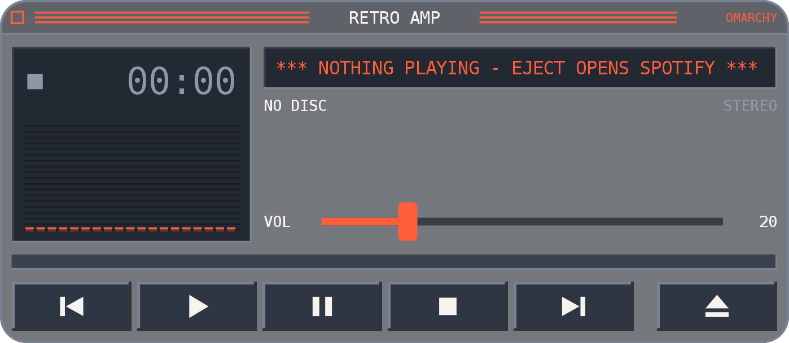

# Retro Amp (Winamp) – KWGT Android Widget

A classic late-90s Winamp-style music player widget for Android home screens (Nova, Samsung One UI, Pixel Launcher, Lawnchair, etc.) powered by **KWGT (Kustom Widget Maker)**.

Inspired by the Omalauncher Retro Amp widget originally created by Bryan Perdana.

---

## ⚡ Direct Download

* **Download Widget Preset:** [**`RetroAmp_Winamp.kwgt`**](https://github.com/arnoldmitre/winamp-kwgt-widget/raw/main/RetroAmp_Winamp.kwgt)
* **Releases Page:** Check the [Releases](https://github.com/arnoldmitre/winamp-kwgt-widget/releases) tab for one-click `.kwgt` asset downloads.

---

## ✨ Features

* **Authentic 90s Aesthetics:** Metallic dark chassis, beveled borders, accent stripes, and retro typography.
* **Sunken Green LCD Display:**
  * **Digital Track Timer:** Real-time track position (`mm:ss`) and duration.
  * **Dynamic Status Indicators:** `PLAY`, `PAUSE`, `STOP`, and `STEREO`.
  * **Bitrate & Sample Rate Header:** Classic `192 kbps 44 kHz` display.
  * **12-Band Equalizer / Spectrum Analyzer:** Visualizer bars reacting to playback state.
  * **Track Marquee:** Automatically displays `$mi(artist)$ - $mi(title)$` (or tap-to-eject when idle).
* **Seekbar:** Dynamic track playback progress bar.
* **Interactive Transport Buttons (Touch Actions):**
  * `|<<` (**PREV**): Skip to previous track
  * `▶` (**PLAY**): Play / Pause toggle (illuminates bright green when playing)
  * `❚❚` (**PAUSE**): Pause (illuminates when paused)
  * `>>|` (**NEXT**): Skip to next track
  * `⏏` (**EJECT**): Opens active music player (Spotify, YouTube Music, Apple Music, etc.)

---

## 📲 How to Install on Android

### 1. Requirements
* [KWGT Kustom Widget Maker](https://play.google.com/store/apps/details?id=org.kustom.widget)
* **KWGT Pro Key** (required by Kustom to import external presets)

### 2. Enable Notification & Media Access
For KWGT to detect playing songs and control playback:
1. Open Android **Settings** $\rightarrow$ **Apps** $\rightarrow$ **Special app access** $\rightarrow$ **Device & app notifications**.
2. Enable access for **KWGT**.
3. In the KWGT app settings, ensure **Preferred Music Player** is set to **Auto** (or choose your preferred music app).

### 3. Import the Widget
1. Download [**`RetroAmp_Winamp.kwgt`**](https://github.com/arnoldmitre/winamp-kwgt-widget/raw/main/RetroAmp_Winamp.kwgt) to your phone.
2. Move it to your phone's internal storage: `Kustom/widgets/RetroAmp_Winamp.kwgt` (or leave it in your `Downloads` folder).
3. Long-press any empty space on your home screen and select **Widgets**.
4. Choose **KWGT** and drag a **4×2** widget onto your screen.
5. Tap the blank widget to open KWGT.
6. Tap the **Library / Exported** tab (or tap the **Import / Folder** icon at the top) and select `RetroAmp_Winamp.kwgt`.
7. Tap the **Save** icon (floppy disk) in the top right corner.
8. Return to your home screen—your Retro Winamp widget is live!

---

## 🛠️ Repository Contents

* `RetroAmp_Winamp.kwgt`: Ready-to-import KWGT widget package.
* `preset.json`: Uncompressed widget structure and formula definitions.
* `generate_kwgt.py`: Python script used to construct and package the `.kwgt` archive.
* `preview.png`: Visual layout preview.

## 📄 License

MIT License. Free to use, modify, and share!
